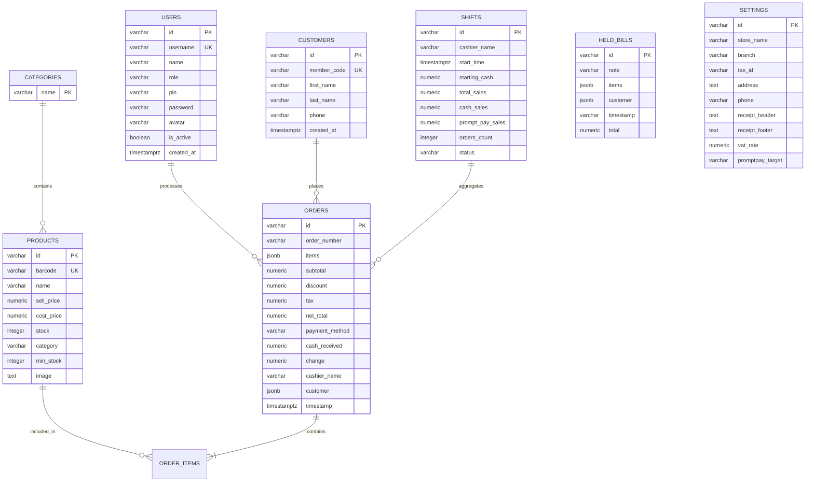

# 🛒 NEXUS POS — ระบบบริหารจัดการจุดขายหน้าร้านครบวงจร

ระบบบริหารจัดการจุดขายหน้าร้าน (Point of Sale - POS) ระดับมืออาชีพ พัฒนาด้วยเทคโนโลยีเว็บสมัยใหม่ รองรับการขายหน้าร้าน สแกนบาร์โค้ด สมาชิก สต็อกสินค้า พิมพ์ใบเสร็จ หน้าจอสองสำหรับลูกค้า และเชื่อมต่อฐานข้อมูล **PostgreSQL** แบบ Local Server รองรับการทำงานที่รวดเร็ว เสถียร และปลอดภัย

---

## 📑 สารบัญ (Table of Contents)
1. [ภาพรวมระบบและฟีเจอร์หลัก (Key Features)](#-ภาพรวมระบบและฟีเจอร์หลัก-key-features)
2. [เทคโนโลยีที่ใช้พัฒนา (Tech Stack)](#-เทคโนโลยีที่ใช้พัฒนา-tech-stack)
3. [โครงสร้างฐานข้อมูล (Database Architecture)](#-โครงสร้างฐานข้อมูล-database-architecture)
4. [วิธีการเปิดดูและเข้าถึงฐานข้อมูล (Database Access)](#-วิธีการเปิดดูและเข้าถึงฐานข้อมูล-database-access)
5. [โครงสร้างบทบาทและสิทธิ์ผู้ใช้งาน (Roles & Permissions)](#-โครงสร้างบทบาทและสิทธิ์ผู้ใช้งาน-roles--permissions)
6. [การติดตั้งและเริ่มใช้งาน (Getting Started)](#-การติดตั้งและเริ่มใช้งาน-getting-started)
7. [รายละเอียด API และเส้นทางบริการ (Backend API Endpoints)](#-รายละเอียด-api-และเส้นทางบริการ-backend-api-endpoints)
8. [โครงสร้างโฟลเดอร์ของโปรเจกต์ (Project Structure)](#-โครงสร้างโฟลเดอร์ของโปรเจกต์-project-structure)

---

## 🚀 ภาพรวมระบบและฟีเจอร์หลัก (Key Features)

### 1. ระบบขายหน้าร้าน (POS Terminal)
- **สแกนบาร์โค้ดและค้นหาสินค้า**: รองรับเครื่องยิงบาร์โค้ด USB/ไร้สาย (Standard Keyboard Wedge) และค้นหาด้วยชื่อสินค้า
- **จัดการตะกร้าสินค้า**: ปรับจำนวน ชิ้นละ / ส่วนลด / คำนวณภาษีมูลค่าเพิ่ม (VAT 7%) อัตโนมัติ
- **ระบบพักบิล (Hold Bills)**: สามารถพักบิลลูกค้าปัจจุบัน เพื่อคิดเงินให้ลูกค้ารายอื่นก่อนได้ และสามารถเรียกคืนบิล (Resume) กลับมาคิดเงินต่อได้ทันที
- **ผูกบิลกับสมาชิก**: สามารถค้นหาและเลือกลูกค้าสมาชิก เพื่อบันทึกประวัติและผูกกับใบเสร็จได้
- **ช่องทางชำระเงินหลากหลาย**:
  - **เงินสด (Cash)**: มีปุ่มลัดระบุจำนวนเงินสด (฿50, ฿100, ฿500, ฿1,000) และคำนวณเงินทอนอัตโนมัติ
  - **พร้อมเพย์ (PromptPay QR)**: สร้าง QR Code มาตรฐาน EMVCo พร้อมยอดเงินที่ต้องชำระจริงทันที
  - **บัตรเครดิต / โอนเงิน (Credit Card / Bank Transfer)**: บันทึกและพิมพ์ใบเสร็จ
- **ระบบพิมพ์ใบเสร็จ (Thermal Receipt Printing)**: ออกแบบรองรับเครื่องพิมพ์สลิปความร้อนหน้ากว้าง **80mm** (Thermal Printer) และหน้า A4 มาตรฐาน
- **เสียงตอบรับ (Sound Effects)**: มีเสียงเตือนขณะสแกนสินค้า, คิดเงินสำเร็จ และแจ้งเตือนข้อผิดพลาด

### 2. หน้าจอแสดงผลสำหรับลูกค้า (Customer-Facing Display Screen)
- มีปุ่มลัดด้านบนโปรแกรม **"🖥️ หน้าจอลูกค้า (Customer Display)"** 
- สามารถลากหน้าต่างแยกออกไปแสดงผลบน **หน้าจอที่สอง (Secondary Monitor)** หันไปทางลูกค้าได้
- แสดงผลยอดเงินและรายการสินค้าที่พนักงานกำลังสแกนแบบ Real-time พร้อมแสดง QR Code พร้อมเพย์ให้ลูกค้าสแกนจ่ายได้ทันที

### 3. ระบบสมาชิก (Customer / Membership Management)
- เพิ่ม ลบ แก้ไข ข้อมูลลูกค้าสมาชิก
- จัดเก็บ: รหัสสมาชิก (`MB-xxx`), ชื่อ-นามสกุล, เบอร์โทรศัพท์ และวันที่ลงทะเบียน
- ค้นหาสมาชิกขณะขายสินค้าผ่านหน้า POS ได้ทันที

### 4. ระบบจัดการผู้ใช้และสิทธิ์การเข้าถึง (User Authentication & RBAC)
- ระบบล็อกอินก่อนเข้าใช้งาน ป้องกันการเข้าถึงข้อมูลโดยไม่ได้รับอนุญาต
- รองรับการล็อกอินด้วย **ชื่อผู้ใช้ + รหัสผ่าน** หรือ **รหัส PIN 4–6 หลัก**
- ฟังก์ชัน **Quick Login**: ปุ่มสลับบัญชีแคชเชียร์ได้อย่างรวดเร็ว
- แบ่งสิทธิ์เป็น 2 ระดับ:
  1. **ADMIN (ผู้จัดการระบบ)**: เข้าถึงได้ทุกฟังก์ชัน (รายงานสถิติ, จัดการสินค้า, จัดการผู้ใช้, ตั้งค่า)
  2. **USER (พนักงานขายหน้าร้าน)**: เข้าถึงได้เฉพาะหน้าขายสินค้า (POS) เท่านั้น ไม่สามารถดูยอดขายหรือแก้ไขข้อมูลระบบได้

### 5. ระบบจัดการสินค้าและสต็อก (Inventory & Stock Management)
- เพิ่ม ลบ แก้ไข ข้อมูลสินค้า พร้อมบาร์โค้ด ราคาขาย ราคาทุน และหมวดหมู่สินค้า
- **ตัดสต็อกอัตโนมัติแบบเรียลไทม์**: ทุกครั้งที่มีการขายสินค้า ระบบจะตัดยอดสต็อกใน PostgreSQL ทันที
- ระบบปรับเพิ่ม-ลดสต็อก (Stock In / Stock Out)
- ระบบแจ้งเตือนสินค้าใกล้หมด (Low Stock Alert)

### 6. ระบบรายงานและสถิติยอดขาย (Analytics & Reports)
- **ออกแบบรองรับหน้าจอ Full HD (1920x1080)**: ปรับสู่เลย์เอาต์แดชบอร์ด 2 ฝั่ง มองเห็นประวัติการขายล่าสุดโดยไม่ต้องเลื่อนจอ (No Scrolling Needed)
- **สรุปตัวเลขสำคัญ (KPIs)**: ยอดขายรวมทั้งหมด, กำไรขั้นต้น (Gross Profit), จำนวนบิลที่ขายได้, ต้นทุนขายรวม (COGS)
- **สถิติช่องทางชำระเงิน**: แยกยอดขายระหว่าง เงินสด, พร้อมเพย์ และบัตรเครดิต
- **สินค้าขายดี 5 อันดับแรก (Top 5 Best Sellers)**: แสดงจำนวนชิ้น ยอดเงิน และกราฟแท่ง
- **ตารางประวัติบิลย้อนหลัง (Transaction History)**:
  - แสดงผลสูงสุด **20 รายการต่อหน้า** พร้อมระบบแบ่งหน้า (Pagination) นำทาง `<<` `<` `หน้า 1, 2...` `>` `>>`
  - ตัวเลือกปรับจำนวนแถวต่อหน้า: 10, 20, 50, 100 รายการ
  - ค้นหาบิลด่วนด้วยเลขที่บิล (`POS-xxx`), แคชเชียร์, หรือชื่อลูกค้า
  - กรองบิลตามช่องทางชำระเงิน
  - ปุ่มพิมพ์ใบเสร็จซ้ำย้อนหลังได้ทุกบิล
  - ปุ่มสลับมุมมอง `[⛶ ขยายเต็มจอ]` / `[◫ มุมมองแยกข้าง]`

### 7. ระบบกะและตั้งค่าร้านค้า (Shift & Store Settings)
- เปิด-ปิดกะการขาย บันทึกเงินทอนเริ่มต้นกะ
- สรุปยอดขายตามกะ แคชเชียร์ผู้รับผิดชอบ
- ตั้งค่าข้อมูลหัว-ท้ายใบเสร็จ, เลขประจำตัวผู้เสียภาษี, เบอร์โทร และเบอร์พร้อมเพย์
- สลับโหมดหน้าจอ Dark Mode / Light Mode

---

## 🛠️ เทคโนโลยีที่ใช้พัฒนา (Tech Stack)

| ส่วนประกอบ | เทคโนโลยีที่เลือกใช้ | รายละเอียด |
|---|---|---|
| **Frontend UI** | **React 18 / 19** + **TypeScript** | พัฒนาด้วย Functional Components และ React Hooks |
| **Styling** | **Vanilla CSS Design System** | ออกแบบด้วย CSS Tokens, Dark/Light Mode, Glassmorphism, Micro-animations |
| **Bundler & Dev** | **Vite** | Build Tool ความเร็วสูง รองรับ Hot Module Replacement (HMR) |
| **Icons** | **Lucide React** | ชุดไอคอน UI คุณภาพสูง |
| **Backend Server** | **Node.js** + **Express** + **tsx** | REST API Server ประสิทธิภาพสูง รองรับ CORS และ Request Proxy |
| **Database** | **PostgreSQL** | ฐานข้อมูลเชิงสัมพันธ์ (RDBMS) ชั้นนำ รันแบบ Local Server |
| **DB Driver** | **node-postgres (`pg`)** | Connection Pool จัดการการเชื่อมต่อและ Atomic Transactions |
| **Process Manager**| **Concurrently** | รัน Server (Port 5001) และ Client (Port 5173) พร้อมกันในคำสั่งเดียว |

---

## 🗄️ โครงสร้างฐานข้อมูล (Database Architecture)

ระบบใช้ฐานข้อมูล **PostgreSQL** ชื่อฐานข้อมูลคือ **`nexus_pos`**

### ข้อมูลการเชื่อมต่อ (Default Connection Details)
- **Host / Server**: `localhost` หรือ `127.0.0.1`
- **Port**: `5432`
- **Database Name**: `nexus_pos`
- **User**: `worracag` *(ชื่อผู้ใช้ของเครื่อง macOS)*
- **Password**: *(เว้นว่างไว้ / ไม่ต้องใช้รหัสผ่าน)*

### รายชื่อตารางในระบบ (Database Tables)



### คำอธิบายตารางสำคัญ
1. **`orders`**: บันทึกประวัติบิลขายทั้งหมด จัดเก็บรายการสินค้าแบบ `jsonb` ยอดสุทธิ ช่องทางชำระเงิน และข้อมูลลูกค้า
2. **`products`**: รายการสินค้า ราคาทุน ราคาขาย สต็อกคงเหลือ และหมวดหมู่
3. **`customers`**: รายชื่อลูกค้าสมาชิก รหัส `MB-xxx` และเบอร์โทรศัพท์
4. **`users`**: บัญชีผู้ใช้งานระบบ แคชเชียร์ แอดมิน รหัส PIN และสิทธิ์การเข้าถึง (`ADMIN` / `USER`)
5. **`shifts`**: บันทึกข้อมูลกะการทำงาน ยอดขายเงินสด และยอดขายพร้อมเพย์ในกะ
6. **`held_bills`**: บิลชั่วคราวที่พักไว้รอการชำระเงิน
7. **`settings`**: ข้อมูลหัวบิลใบเสร็จ อัตราภาษี และเบอร์พร้อมเพย์รับเงิน
8. **`categories`**: รายชื่อหมวดหมู่สินค้าในร้านค้า

---

## 🔍 วิธีการเปิดดูและเข้าถึงฐานข้อมูล (Database Access)

### วิธีที่ 1: ดูผ่านโปรแกรม GUI (แนะนำสำหรับ macOS)
สามารถติดตั้งโปรแกรมเปิดดูฐานข้อมูลที่ใช้งานง่าย เช่น:
- **TablePlus** (แนะนำที่สุด):
  ```bash
  brew install --cask tableplus
  ```
- **Postico 2** (โปรแกรมเฉพาะ PostgreSQL บน Mac):
  ```bash
  brew install --cask postico
  ```
- **DBeaver** (ฟรีและ Open Source):
  ```bash
  brew install --cask dbeaver-community
  ```

**ค่าที่ใช้ตั้งค่าในโปรแกรม:**
- **Host**: `localhost`
- **Port**: `5432`
- **Database**: `nexus_pos`
- **User**: `worracag`
- **Password**: *(เว้นว่างไว้)*

### วิธีที่ 2: ดูผ่าน Command Line (Terminal)
สามารถเปิด Terminal แล้วพิมพ์คำสั่งนี้เพื่อเข้าสู่ PostgreSQL CLI ได้ทันที:
```bash
psql -d nexus_pos
```

**คำสั่งที่ใช้บ่อยใน psql:**
```sql
-- ดูตารางทั้งหมด
\dt

-- ดูประวัติบิลขายล่าสุด
SELECT order_number, timestamp, cashier_name, net_total, payment_method FROM orders ORDER BY timestamp DESC;

-- ดูสินค้าและสต็อกคงเหลือ
SELECT barcode, name, sell_price, stock FROM products;

-- ดูรายชื่อสมาชิก
SELECT member_code, first_name, last_name, phone FROM customers;

-- ออกจากโปรแกรม psql
\q
```

---

## 👥 โครงสร้างบทบาทและสิทธิ์ผู้ใช้งาน (Roles & Permissions)

| สิทธิ์ / สิทธิ์การใช้งาน | ผู้จัดการระบบ (ADMIN) | แคชเชียร์ / พนักงานขาย (USER) |
|---|:---:|:---:|
| **ขายหน้าร้าน (POS)** | ✅ เข้าถึงได้ | ✅ เข้าถึงได้ |
| **สแกนบาร์โค้ด / พักบิล / คืนบิล** | ✅ เข้าถึงได้ | ✅ เข้าถึงได้ |
| **รับชำระเงิน (เงินสด/พร้อมเพย์/บัตร)** | ✅ เข้าถึงได้ | ✅ เข้าถึงได้ |
| **เลือกลูกค้าสมาชิกผูกกับบิล** | ✅ เข้าถึงได้ | ✅ เข้าถึงได้ |
| **ดูรายงานสรุปยอดขาย (Analytics)** | ✅ เข้าถึงได้ | ❌ ไม่มีสิทธิ์ |
| **ดูต้นทุนและอัตรากำไรขั้นต้น** | ✅ เข้าถึงได้ | ❌ ไม่มีสิทธิ์ |
| **จัดการสินค้าและสต็อก (Inventory)** | ✅ เข้าถึงได้ | ❌ ไม่มีสิทธิ์ |
| **จัดการบัญชีลูกค้าสมาชิก** | ✅ เข้าถึงได้ | ❌ ไม่มีสิทธิ์ |
| **จัดการผู้ใช้งานระบบ (User Accounts)** | ✅ เข้าถึงได้ | ❌ ไม่มีสิทธิ์ |
| **ตั้งค่าระบบร้านค้า (Settings)** | ✅ เข้าถึงได้ | ❌ ไม่มีสิทธิ์ |

### บัญชีผู้ใช้เริ่มต้นในระบบ (Default Demo Accounts)
- **แอดมิน (Admin)**: 
  - Username: `admin` / Password: `admin` / PIN: `1234`
- **แคชเชียร์ 01 (User)**: 
  - Username: `cashier1` / Password: `user` / PIN: `0000`

---

## 💻 การติดตั้งและเริ่มใช้งาน (Getting Started)

### ความต้องการของระบบ (Prerequisites)
- **macOS** (รองรับทั้ง Apple Silicon M-Series และ Intel)
- **Node.js** (v18 หรือสูงกว่า)
- **PostgreSQL** (ติดตั้งผ่าน Homebrew และกำลังทำงานอยู่: `brew services start postgresql@14` หรือเวอร์ชันที่ใช้งาน)

### ขั้นตอนการรันโปรเจกต์ (Run Project)

1. เข้าสู่โฟลเดอร์ของโปรเจกต์:
   ```bash
   cd "/Users/worracag/Desktop/TEST POS"
   ```

2. ติดตั้ง Dependencies (หากยังไม่ได้ติดตั้ง):
   ```bash
   npm install
   ```

3. รันโปรแกรมในโหมด Development:
   ```bash
   npm run dev
   ```
   > คำสั่งนี้จะเริ่มต้นทั้ง **Express API Server (Port 5001)** และ **Vite Client (Port 5173)** พร้อมกันอัตโนมัติ

4. เปิดเว็บบราวเซอร์ไปที่:
   ```
   http://localhost:5173/
   ```

---

## 🌐 รายละเอียด API และเส้นทางบริการ (Backend API Endpoints)

เซิร์ฟเวอร์ Express ให้บริการ API ภายใต้ Prefix `/api`:

### 1. สถานะระบบ
- `GET /api/health` — ตรวจสอบสถานะการเชื่อมต่อฐานข้อมูล PostgreSQL

### 2. สินค้าและสต็อก (Products)
- `GET /api/products` — ดึงรายการสินค้าและสต็อกทั้งหมด
- `POST /api/products` — เพิ่มสินค้าใหม่
- `PUT /api/products/:id` — แก้ไขข้อมูลสินค้า
- `PATCH /api/products/:id/stock` — ปรับสต็อกสินค้าเข้า-ออก
- `DELETE /api/products/:id` — ลบสินค้า

### 3. หมวดหมู่สินค้า (Categories)
- `GET /api/categories` — ดึงรายชื่อหมวดหมู่
- `POST /api/categories` — เพิ่มหมวดหมู่ใหม่
- `DELETE /api/categories/:name` — ลบหมวดหมู่

### 4. สมาชิก (Customers)
- `GET /api/customers` — ดึงรายชื่อสมาชิกทั้งหมด
- `POST /api/customers` — เพิ่มสมาชิกรหัสใหม่
- `PUT /api/customers/:id` — อัปเดตข้อมูลสมาชิก
- `DELETE /api/customers/:id` — ลบสมาชิก

### 5. ผู้ใช้งานและยืนยันตัวตน (Users & Auth)
- `GET /api/users` — รายชื่อบัญชีผู้ใช้งาน
- `POST /api/users` — เพิ่มผู้ใช้งานใหม่
- `PUT /api/users/:id` — แก้ไขผู้ใช้งาน
- `DELETE /api/users/:id` — ลบผู้ใช้งาน (ระบบจะบล็อกไม่ให้ลบแอดมินคนสุดท้าย)
- `POST /api/users/login` — ตรวจสอบการเข้าสู่ระบบด้วย Username/Password หรือ PIN

### 6. การขายและบิล (Orders & Checkout)
- `GET /api/orders` — ดึงประวัติบิลขายทั้งหมด เรียงลำดับจากล่าสุด
- `POST /api/orders` — บันทึกบิลขายใหม่ (ทำงานแบบ **Atomic Transaction**: บันทึกบิล + ตัดสต็อกสินค้า + อัปเดตยอดกะขาย ใน Transaction เดียว)

### 7. บิลพัก (Held Bills)
- `GET /api/held-bills` — ดึงรายการบิลที่พักไว้
- `POST /api/held-bills` — บันทึกบิลพัก
- `DELETE /api/held-bills/:id` — ลบหรือคืนบิลพัก

### 8. การตั้งค่าและกะ (Settings & Shift)
- `GET /api/settings` — ดึงข้อมูลการตั้งค่าร้านค้า
- `PUT /api/settings` — อัปเดตข้อมูลร้านค้า
- `GET /api/shift` — ดึงสถานะกะขายปัจจุบัน
- `POST /api/shift/open` — เปิดกะใหม่พร้อมระบุเงินเริ่มต้นกะ

---

## 📁 โครงสร้างโฟลเดอร์ของโปรเจกต์ (Project Structure)

```text
TEST POS/
├── server/                     # Backend Node.js & Database
│   ├── db.ts                   # PostgreSQL Connection Pool & Table Schema Seeding
│   └── index.ts                # Express REST API Routes & Controllers
├── src/                        # Frontend Application
│   ├── components/             # React View Components
│   │   ├── AnalyticsView.tsx   # รายงานยอดขายและประวัติบิล (Full HD Dashboard & Pagination)
│   │   ├── CustomerDisplayView.tsx # หน้าจอแสดงผลสำหรับลูกค้า (Dual Screen)
│   │   ├── CustomersView.tsx   # ระบบจัดการข้อมูลลูกค้าสมาชิก
│   │   ├── Header.tsx          # แถบเมนูด้านบน แสดงสถานะ DB และปุ่มเปิดจอลูกค้า
│   │   ├── InventoryView.tsx   # ระบบจัดการสินค้าและสต็อก
│   │   ├── LoginView.tsx       # หน้าจอเข้าสู่ระบบ (PIN / Password)
│   │   ├── NavigationSidebar.tsx # เมนูด้านข้าง สลับแท็บและเปลี่ยนผู้ใช้
│   │   ├── PaymentModal.tsx    # หน้าต่างชำระเงิน (เงินสด, PromptPay QR, บัตร)
│   │   ├── ReceiptModal.tsx    # หน้าต่างแสดงและพิมพ์ใบเสร็จ (80mm Thermal Printer)
│   │   ├── SettingsView.tsx    # หน้าต่างตั้งค่าร้านค้าและสลับธีม
│   │   ├── Terminal.tsx        # หน้าจอขายสินค้าหน้าร้าน (POS Terminal)
│   │   └── UsersView.tsx       # ระบบจัดการผู้ใช้และบทบาท (Admin / User)
│   ├── context/
│   │   └── POSContext.tsx      # Central State Management & PostgreSQL Data Sync
│   ├── data/
│   │   └── initialData.ts      # ข้อมูลเริ่มต้นและ Type Initializers
│   ├── services/
│   │   └── api.ts              # API Client Service เชื่อมต่อกับ Backend
│   ├── types/
│   │   └── pos.ts              # TypeScript Data Models & Interfaces
│   ├── utils/
│   │   ├── promptpay.ts        # โมดูลสร้าง Payload EMVCo QR Code สำหรับ PromptPay
│   │   └── sound.ts            # Web Audio API สร้างเสียงปี๊บและเสียงแจ้งเตือน
│   ├── App.tsx                 # Root Component ควบคุมการเปลี่ยนหน้า
│   ├── index.css               # ระบบ CSS Design Tokens และ Responsive Layouts
│   └── main.tsx                # React DOM Entry Point
├── package.json                # Project Scripts & Dependencies
├── tsconfig.json               # TypeScript Configuration
├── vite.config.ts              # Vite Config & Proxy `/api` -> `http://localhost:5001`
└── README.md                   # เอกสารคู่มือระบบฉบับสมบูรณ์
```

---

## 🔒 สถาปัตยกรรมความปลอดภัยและการสำรองข้อมูล (Security Architecture & Backup)

ระบบ NEXUS POS ผ่านการตรวจสอบความปลอดภัยระดับ Senior Application Security พร้อมมาตรการป้องกันเชิงลึก (Defense in Depth):

1. **การปกป้องรหัสผ่านและ PIN (Password & PIN Hashing)**:
   - จัดเก็บด้วย **Bcrypt** (Salt rounds = 10) บน PostgreSQL
   - ไม่มีข้อมูลรหัสผ่านหรือ PIN ในรูปแบบ Plaintext ทั้งใน Database, API Response (`GET /api/users`), หรือ LocalStorage
2. **การป้องกันการปลอมแปลงยอดเงินและสต็อก (Price & Stock Tampering Defense)**:
   - ฝั่ง Backend ตรวจสอบราคาสินค้าจริงจาก Database เสมอ (Server-side Total Recalculation) ป้องกันกรณีผู้โจมตีแก้ไข `netTotal` บน Browser
   - ใช้ Row-Level Locking (`SELECT FOR UPDATE`) ใน Transaction เพื่อป้องกันปัญหา Concurrency, Overselling หรือสต็อกติดลบ
3. **การป้องกัน Brute Force & Rate Limiting**:
   - ป้องกันการเดารหัสผ่านที่ `POST /api/users/login` ด้วย `express-rate-limit` (จำกัด 10 ครั้ง/นาที ต่อ IP)
4. **การควบคุมการเข้าถึงคำสั่งอันตราย (Protected Admin Endpoints)**:
   - คำสั่งรีเซ็ตฐานข้อมูล `POST /api/reset` จำเป็นต้องระบุคีย์ลับ `x-admin-reset-key` (`ADMIN_RESET_SECRET`) และถูกบล็อกไม่ให้ทำงานใน Production
5. **ความปลอดภัยระดับ Web Headers (Helmet & Strict CORS)**:
   - ติดตั้ง `helmet` ป้องกัน Clickjacking (`X-Frame-Options: SAMEORIGIN`), MIME Sniffing (`X-Content-Type-Options: nosniff`) และบังคับ HTTPS HSTS
   - กำหนดสิทธิ์ CORS ให้เฉพาะ Local Origin ที่ได้รับอนุญาต
6. **การรันชุดทดสอบความปลอดภัยอัตโนมัติ (Security Audit Verification Suite)**:
   - สามารถรันตรวจสอบความปลอดภัยทั้ง 9 รายการได้ด้วยคำสั่ง:
     ```bash
     npx tsx scripts/verify_security.ts
     ```
7. **คำแนะนำการสำรองและกู้คืนข้อมูล (Backup & Recovery)**:
   - **สำรองข้อมูล (Backup Database)**:
     ```bash
     pg_dump -U $(whoami) nexus_pos > backup_nexus_pos_$(date +%Y%m%d).sql
     ```
   - **กู้คืนข้อมูล (Restore Database)**:
     ```bash
     psql -U $(whoami) -d nexus_pos -f backup_nexus_pos_YYYYMMDD.sql
     ```
